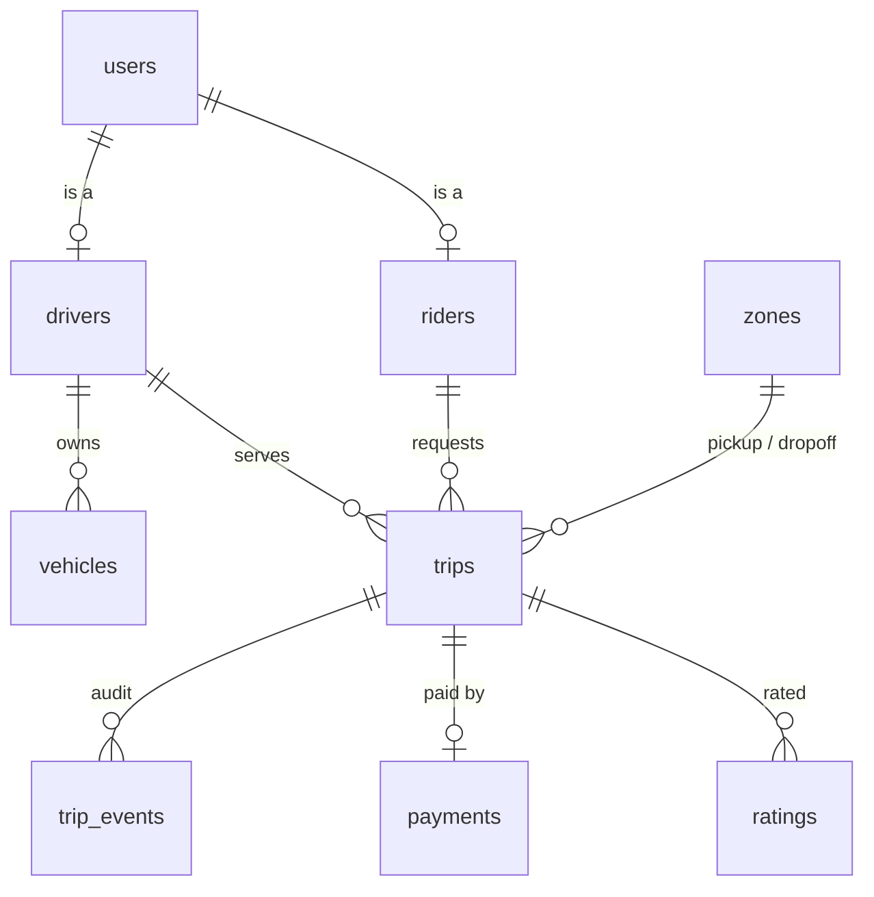

# Taximan

A ride hailing data platform on MySQL 8, built the way a production system
relies on its database: a normalised schema with foreign keys, CHECK
constraints and purpose chosen indexes; business rules enforced by triggers so
bad data is rejected at write time no matter which client writes it; a
transactional service layer and HTTP API on top; twelve analytical queries
over a year of generated activity; and a concurrency lab that reproduces a
lost update and a double booking with two live connections, then shows the
lock that fixes each.

```
make bootstrap      # venv, MySQL in Docker, migrations, 300k trips of seed data
make test           # 51 tests against a real MySQL, ~7 seconds
make analytics      # the 12 queries
make lab            # the concurrency demonstrations
make serve          # FastAPI on http://127.0.0.1:8000/docs
```

## What is in the box

| area | where | what |
|---|---|---|
| Schema | `db/migrations/001_schema.sql` | 9 tables in 3NF, 13 foreign keys with explicit ON DELETE, 13 CHECK constraints, 8 unique and 13 secondary indexes, a generated column enforcing one active vehicle per driver |
| Rules | `db/migrations/002_triggers.sql` | 10 triggers: trip state machine, terminal immutability, driver availability with a locking read, rating and payment eligibility, atomic rating aggregates, append only audit log |
| Read models | `db/migrations/003_views.sql` | driver profile, rider profile, trip detail |
| Migrations | `src/taximan/migrate.py` | forward only, checksummed, understands `DELIMITER` |
| Domain | `src/taximan/services.py` | every operation is parameterised SQL inside one transaction |
| API | `src/taximan/api.py` | FastAPI, trigger errors mapped to 404 / 409 / 422 |
| Data | `src/taximan/generate.py` | 20k riders, 2.5k drivers, 300k trips over a year, loaded with `LOAD DATA LOCAL INFILE` while every trigger fires |
| Analytics | `db/analytics/*.sql` | 12 queries with joins, CTEs and window functions, all under 2 s on the full seed |
| Concurrency | `concurrency/` | lost update, double booking and dispatcher starvation, each reproduced and fixed, with the precedence graphs in `SCHEDULES.md` |
| Tests | `tests/` | 51 tests: constraints, state machine, rules, dataset integrity, races, analytics, HTTP |
| CI | `.github/workflows/ci.yml` | MySQL service container, pytest, and the lab must print CORRECT |

## The schema



`users` is the single identity. `riders` and `drivers` are subtypes on the
same key. `trips` is the fact table with a five state lifecycle. `trip_events`
is written only by triggers. `payments` is one per completed trip and must
equal the fare. `ratings` are one per trip per direction and feed the
aggregates on `riders` and `drivers` through atomic increments. Full column
lists and the reasoning for each design choice are in
[docs/ARCHITECTURE.md](docs/ARCHITECTURE.md).

## Rules the database enforces

Try any of these from a raw MySQL shell and the write is refused with
`SQLSTATE 45000` and a stable error code the API turns into an HTTP status.

| attempt | result |
|---|---|
| complete a trip that was never started | `TRIP_INVALID_TRANSITION` |
| change anything on a completed or cancelled trip | `TRIP_TERMINAL` |
| accept a trip for a driver who is on another trip | `DRIVER_UNAVAILABLE` |
| accept with a vehicle that is not the driver's active one | `VEHICLE_MISMATCH` |
| rate a trip that is not completed | `RATING_NOT_COMPLETED` |
| rate the same trip twice from the same side | duplicate key |
| score of 0 or 6 | CHECK constraint |
| pay an amount that is not the fare | `PAYMENT_AMOUNT_MISMATCH` |
| refund a payment that was never captured | `PAYMENT_INVALID_TRANSITION` |
| register a second active vehicle | duplicate key on the generated column |
| go online before approval | `DRIVER_NOT_APPROVED` |
| write timestamps that go backwards | `TRIP_TIME_ORDER` |

`tests/test_state_machine.py`, `tests/test_rules.py` and
`tests/test_constraints.py` exercise every row of that table.

## Concurrency

`concurrency/SCHEDULES.md` traces four schedules. Two of them are the
anomalies a ride hailing database actually suffers from, and both are
executed for real:

**Lost update.** Two riders rate the same driver at once. Each transaction
reads `rating_sum`, adds its score, writes back. The second write overwrites
the first. Precedence graph `T1 -> T2 -> T1`, a cycle, not serializable. The
fix in this repo is that `trg_ratings_ai` does `SET rating_sum = rating_sum +
score`, so there is no application read to go stale.

**Double booking.** Two dispatchers see the same driver as available and both
assign him. Same cycle. The fix is that `trg_trips_bu` checks the driver with
`SELECT ... FOR UPDATE`, so the second dispatcher blocks, then sees `on_trip`
and is rejected with `DRIVER_UNAVAILABLE`.

```
$ make lab
── A. naive read-modify-write ──
   18.1 ms  T1  read sum=100 count=20
   20.1 ms  T2  read sum=100 count=20
  323.1 ms  T1  UPDATE drivers SET rating_sum=105, rating_count=21
  325.2 ms  T2  UPDATE drivers SET rating_sum=104, rating_count=21  (waits if row is locked)
  335.0 ms  T1  COMMIT
  340.9 ms  T2  COMMIT
final rating_sum=104 rating_count=21   expected (109, 22)   LOST UPDATE

── C. atomic UPDATE x = x + d ──
final rating_sum=109 rating_count=22   expected (109, 22)   CORRECT

── Part 3. platform path: services.accept_trip + trg_trips_bu FOR UPDATE ──
   16.4 ms  T1  BEGIN; accept_trip(trip=300002, driver=22504)
   16.5 ms  T2  BEGIN; accept_trip(trip=300003, driver=22504)
  239.0 ms  T2  COMMIT, accepted
  243.9 ms  T1  rejected by database: DRIVER_UNAVAILABLE
outcomes=['DRIVER_UNAVAILABLE', 'accepted']  trips assigned to driver=1   CORRECT
```

The third demonstration is not a serializability failure but a throughput
one: `SELECT ... ORDER BY ... LIMIT 1 FOR UPDATE` locks every row it examines
before sorting, so one dispatcher starves the rest. `services.dispatch_trip`
ranks candidates without locks and then locks one row at a time with
`SKIP LOCKED`. Eight dispatchers against three drivers produce three accepts
and no double assignment.

## Analytics

Twelve questions the business would ask, answered in SQL over the 300k trip
seed. Each file has the question in its header. A few:

| query | technique |
|---|---|
| driver earnings leaderboard with dollars per hour and multiple of the average | CTE, 4 table join, `RANK() OVER`, `AVG() OVER ()` |
| rider retention by signup cohort, months 0 to 3 | two CTEs, conditional `COUNT(DISTINCT)` |
| Bayesian shrinkage of driver ratings | cross join to a global stat, two rankings compared |
| time to accept p50 / p90 / p99 by zone | `ROW_NUMBER` and `COUNT` over partitions |
| daily revenue with running total, 7 day average and week over week growth | `SUM OVER`, `AVG OVER ROWS BETWEEN`, `LAG` |
| drivers whose last 20 ratings fell 0.5 below their prior 20 | `ROW_NUMBER` by recency, conditional averages |
| origin destination flow, top 3 destinations per origin | self join of zones, `RANK() OVER (PARTITION BY)` |

`make analytics` prints all twelve with timings. `GET /analytics/{name}`
serves them as JSON.

## API

```
POST /users                       POST /trips                    POST /trips/{id}/payment
POST /riders                      POST /trips/{id}/dispatch      POST /trips/{id}/ratings
POST /drivers                     POST /trips/{id}/accept        GET  /trips/{id}
POST /drivers/{id}/approve        POST /trips/{id}/start         GET  /trips/{id}/events
PUT  /drivers/{id}/status         POST /trips/{id}/complete      GET  /drivers/{id}/earnings
POST /drivers/{id}/vehicles       POST /trips/{id}/cancel        GET  /analytics/{name}
```

Handlers open one transaction, call the domain layer, and return. A rule
rejection raised by a trigger becomes a JSON error with the code above and
HTTP 409 (state conflict), 422 (shape) or 404. Authentication is out of scope
for this repository; `services.verify_password` is where a token layer would
plug in.

## Data

`taximan seed --scale 1` generates and loads in about a minute:

| table | rows |
|---|---|
| users | 22,500 |
| trips | 300,000 over 365 days |
| payments | 266,706 |
| ratings | 280,328 |
| trip_events | 300,000, written by trigger during the load |

Demand follows an hour of day curve with commute peaks, a day of week curve,
a seasonal cycle and year over year growth. Surge follows demand. Rider
activity is power law distributed. Drivers are assigned greedily so nobody in
the generated history is on two trips at once, and `tests/test_integrity.py`
checks that plus the trigger maintained aggregates against a from scratch
recomputation.

## Running it

Requirements: Docker, Python 3.11+.

```bash
git clone <this repo> && cd taximan-platform
cp .env.example .env
make bootstrap                # ~2 minutes, most of it the seed
make test
make lab
make serve                    # then open http://127.0.0.1:8000/docs
```

`make bootstrap` runs `docker compose up`, applies the migrations and loads
the seed. Use `SCALE=0.1 make seed` for a smaller dataset. Every command is
also available as `taximan <command>` inside the virtualenv.

## Layout

```
db/migrations/      001_schema.sql  002_triggers.sql  003_views.sql
db/analytics/       01 .. 12 .sql
src/taximan/        config.py db.py migrate.py services.py pricing.py generate.py analytics.py api.py cli.py
concurrency/        lost_update.py double_booking.py dispatch.py SCHEDULES.md
tests/              9 test modules, 51 tests
docs/               ARCHITECTURE.md
```

## Origins

This replaces an earlier course project of the same name, which had four
tables, string built SQL, plaintext passwords and a serializability argument
that turned out to be wrong. Everything here was rebuilt from scratch with the
opposite priorities: the database enforces the rules, the application never
trusts itself, and every claim in this README is backed by a test or a script
you can run.
