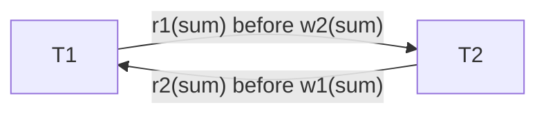
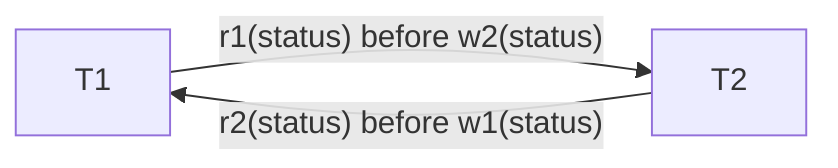
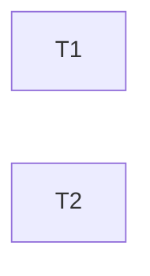

# Transaction schedules and serializability

This document traces the two concurrency anomalies that a ride hailing
database actually suffers from, shows the precedence graph for each, and
explains which lock makes the schedule serializable. Every schedule here is
executed for real by the scripts in this folder against MySQL 8 InnoDB under
its default isolation level, REPEATABLE READ.

```
taximan lab lost-update       # concurrency/lost_update.py
taximan lab double-booking    # concurrency/double_booking.py
taximan lab dispatch          # concurrency/dispatch.py
```

## Vocabulary

* `r1(x)` transaction 1 reads item x, `w2(x)` transaction 2 writes item x.
* Two operations **conflict** when they belong to different transactions, touch
  the same item, and at least one is a write.
* The **precedence graph** has one node per transaction and an edge
  `Ti -> Tj` whenever an operation of Ti conflicts with a later operation of Tj.
* A schedule is **conflict serializable** if and only if the graph is acyclic.

## Schedule 1. Lost update on a rating aggregate

Two riders rate the same driver at the same moment. Each transaction reads
the driver's `rating_sum`, adds its score, and writes the result back.

| step | T1 | T2 | note |
|---|---|---|---|
| 1 | `r1(sum)` = 100 | | plain read under REPEATABLE READ |
| 2 | | `r2(sum)` = 100 | same snapshot |
| 3 | `w1(sum = 105)` | | takes the row lock |
| 4 | | `w2(sum = 104)` | **blocks** on the lock |
| 5 | commit | | lock released |
| 6 | | write proceeds, commit | overwrites 105 with 104 |

Final value 104. The correct value is 109. T1's rating is lost.

Conflicts. `r1(sum)` at step 1 precedes `w2(sum)` at step 4, so `T1 -> T2`.
`r2(sum)` at step 2 precedes `w1(sum)` at step 3, so `T2 -> T1`.



The graph has a cycle. The schedule is not conflict serializable, and the
lost value is the observable proof.

**Why InnoDB does not prevent it.** REPEATABLE READ gives every plain
`SELECT` a consistent snapshot. Row locks are only taken by writes and by
locking reads. T2's snapshot read at step 2 is legal, and T2's write at step 6
is legal because the lock is free by then. The anomaly is in the application
pattern, read then compute then write, not in the engine.

**Fix A, locking read.** `SELECT ... FOR UPDATE` at steps 1 and 2. T2's read
now blocks until T1 commits and then sees 105. The interleaving becomes
serial, `T1` then `T2`, and the graph loses its back edge.

**Fix B, atomic write.** `UPDATE drivers SET rating_sum = rating_sum + 5`.
There is no application side read at all. The arithmetic happens inside the
engine under the row lock. This is what `trg_ratings_ai` in
`db/migrations/002_triggers.sql` does, so the platform never issues the
pattern from step 1 in the first place.

## Schedule 2. Double booking a driver

Two trips are dispatched to the same available driver at the same moment.
Each transaction checks the driver's status, then assigns the trip and flips
the driver to on_trip.

| step | T1 | T2 | note |
|---|---|---|---|
| 1 | `r1(driver.status)` = available | | plain read |
| 2 | | `r2(driver.status)` = available | same snapshot |
| 3 | `w1(trip1.driver = D)` | | own row, no conflict |
| 4 | `w1(driver.status = on_trip)` | | takes the driver lock |
| 5 | | `w2(trip2.driver = D)` | own row, no conflict |
| 6 | | `w2(driver.status = on_trip)` | **blocks** |
| 7 | commit | | |
| 8 | | write proceeds, commit | |

Both transactions commit. Two trips carry `driver_id = D`. The driver is
on two rides at once.

Conflicts. `r1(status)` precedes `w2(status)`, so `T1 -> T2`. `r2(status)`
precedes `w1(status)`, so `T2 -> T1`. The trip rows never conflict because
each transaction writes only its own trip.



Cycle. Not conflict serializable.

**Fix, lock the driver row before deciding.** In `trg_trips_bu` the status
check is `SELECT status INTO v_driver_status FROM drivers WHERE user_id =
NEW.driver_id FOR UPDATE`. Because the read is a locking read, T2's step 2
blocks behind T1 until T1 commits at step 7. T2 then reads `on_trip` and the
trigger raises `SIGNAL SQLSTATE '45000'` with `DRIVER_UNAVAILABLE`. T2 is
rolled back. The schedule that actually executes is serial, `T1` then `T2`,
and the graph is a single edge `T1 -> T2`.

The check lives in the trigger rather than in `services.accept_trip` so that
any client, including a raw `UPDATE trips` from a shell, gets the same
guarantee. `concurrency/double_booking.py` part 3 runs the real service path
and asserts exactly one accept succeeds.

## Schedule 3. A conflict serializable interleaving

Not every interleaving is dangerous. T1 completes trip 41 and T2 rates trip
17, whose driver is a different person.

| step | T1 | T2 |
|---|---|---|
| 1 | `r1(trip41)` | |
| 2 | | `r2(trip17)` |
| 3 | `w1(trip41.status = completed)` | |
| 4 | | `w2(ratings)` insert |
| 5 | `w1(driverA.status = available)` | |
| 6 | | `w2(driverB.rating_sum)` |
| 7 | commit | commit |

No two operations touch the same item. The precedence graph has no edges at
all, so the schedule is trivially conflict serializable and equivalent to
either serial order.



If T2 had rated a trip whose driver is driverA, step 6 would write
`driverA.rating_sum` while T1 writes `driverA.status`. Those are different
columns of the same row. InnoDB locks rows, not columns, so the second writer
blocks until the first commits. The schedule is still serializable, it is
just no longer free of waits.

## Schedule 4. Dispatcher starvation and SKIP LOCKED

Eight dispatchers run at once against three available drivers. Each does
`SELECT ... FROM drivers WHERE status = 'available' ORDER BY rank LIMIT 1 FOR
UPDATE`. InnoDB locks every row the statement examines before sorting, so the
first dispatcher locks all three drivers, the other seven wait, and when the
lock is released they all find the rows already `on_trip`. Seven trips report
no driver although two drivers were idle the entire time.

This is not a serializability failure. The schedule is serializable. It is a
throughput failure caused by locking more than the decision needs.

`services.dispatch_trip` therefore ranks candidates with a plain read, then
locks one candidate at a time with `SELECT ... FOR UPDATE SKIP LOCKED`. A
locked row is skipped instead of waited on. `concurrency/dispatch.py` shows
three accepts and five honest no driver responses, with every driver assigned
exactly once.

## Summary

| schedule | anomaly | graph | fix in this repo |
|---|---|---|---|
| 1 | lost update | cycle | `trg_ratings_ai` atomic `x = x + d` |
| 2 | double booking | cycle | `trg_trips_bu` locking read on driver |
| 3 | none | no edges | nothing needed |
| 4 | starvation, not an anomaly | acyclic | `SKIP LOCKED` one row at a time |
