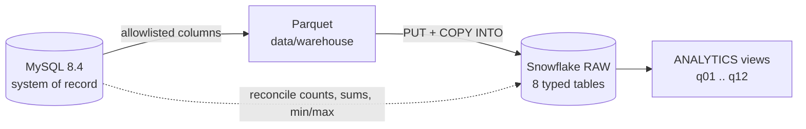

# Snowflake analytics layer

MySQL stays the system of record. This optional layer copies a PII free subset of it to Snowflake, rebuilds the twelve analytical queries there as views, and proves the copy and the views match MySQL.

It exists to show the split a real product ends up with. Transactions, constraints and triggers live in MySQL, where they belong. Analytical reads move to a warehouse so they never compete with bookings for locks.



```bash
make warehouse-setup     # once: warehouse, database, schemas, file format, stage
make warehouse           # extract, load, build the views, reconcile against MySQL
```

## What leaves MySQL

An allowlist in `src/taximan/warehouse/spec.py` names every column that is extracted, 59 across 8 tables. A column that is not listed is never selected, so adding a column to the OLTP schema cannot leak it by accident.

| never extracted | why |
|---|---|
| the whole `users` table (email, phone, password hash, full name) | credentials and personal data, and no query needs them |
| `drivers.licence_no`, `vehicles.plate` | identifiers issued by third parties |
| `ratings.comment` | free text can contain anything |

Drivers and riders are identified by id in the warehouse, so the four queries that showed `full_name` in MySQL return `driver_id` or `rider_id` instead. Tests check the allowlist, the `RAW` DDL and every extracted Parquet schema against a list of forbidden column names, and that each view reads only allowlisted tables.

A full extract of the 300,001 trip database takes about 10 seconds and writes 34 MB of Parquet.

## The views

`warehouse/snowflake/analytics/` holds one view per MySQL query, with the same number and name, plus `00_as_of.sql`.

Every "last 30 days" window in MySQL hangs off `UTC_TIMESTAMP()`, so the answer changes each time it runs. The views hang off `analytics.as_of`, the latest request in the data, so a reload of the same extract gives the same numbers whenever it is queried. A test fails if any view reads the wall clock. Against continuously loaded data this one view would become `CURRENT_TIMESTAMP()`.

## Porting MySQL to Snowflake: what changed and why

| MySQL | Snowflake | why it matters |
|---|---|---|
| `SUM(status = 'x')` | `COUNT_IF(status = 'x')` | summing a boolean is MySQL only |
| `TIMESTAMPDIFF(SECOND, a, b)` | `TRUNC(DATEDIFF('millisecond', a, b) / 1000)` | `DATEDIFF('second')` counts second boundaries crossed. 0.8 s to 5.5 s is 4.7 s elapsed, MySQL says 4 and a plain `DATEDIFF` says 5. A 2 ms gap that straddles a second boundary gives 1 instead of 0. |
| `TIMESTAMPDIFF(MONTH, a, b)` | calendar month difference (`DATEDIFF('month')`) | MySQL truncates toward zero, so an event up to a month before the cohort month counted as month 0 |
| `ROW_NUMBER` and `CEIL(p * n)` for percentiles | `PERCENTILE_DISC(p) WITHIN GROUP` | nearest rank, so it returns exactly the value the MySQL workaround picked |
| outer `WHERE rank <= 3` over a CTE | `QUALIFY rank <= 3` | same result, one less CTE |
| `LIMIT 20` | removed, `ORDER BY` kept | a view should return the whole ranked set and let the consumer cut it |
| `NTILE(100)` for the median | unchanged | `MEDIAN` and `PERCENTILE_CONT` interpolate and would not reproduce the original numbers |

## What the parity test found

Every ported view is compared with the MySQL query it came from, row for row. On the first full run against the 300,001 trip database, 8 of 12 agreed and 4 did not. In all four the MySQL original was the less accurate side, and both were fixed to the same exact formulation.

* **Q01 dollars per hour.** MySQL stored `seconds / 3600.0` in the CTE at 4 decimals, so a 667 second trip came out at 128.71 instead of the exact 128.73, and 874.25 instead of 876.00 for shorter trips. Now `gross_cents * 36 / seconds`, one division.
* **Q06 and Q07 ranks.** MySQL decimal division keeps 4 digits, which turned 29 distinct driver averages into ties (948 distinct values against 977 exact among 2,501 drivers) and shifted ranks. Ranks now order by `DOUBLE` ratios.
* **Q03 retention.** `TIMESTAMPDIFF(MONTH)` truncation, described above. It also exposed a data problem, see Known issue below.

After the fixes all 12 agree, on the full database and in CI on a scale 0.1 seed.

Ties were a second source of drift. `ROW_NUMBER` in Q05 and Q11 now has a tie-breaker, so equal values always rank the same way in both engines.

## How it is verified

| check | proves | does not prove |
|---|---|---|
| parity test: ported SQL transpiled to DuckDB in strict mode, run over the same Parquet, compared with MySQL | the logic of each port, including joins, windows and rounding | Snowflake specific behaviour |
| `sqlglot` Snowflake parser, plus the connector's own statement splitter | the SQL is valid Snowflake syntax and splits into the intended statements | that Snowflake accepts every option |
| DDL against the extract spec, forbidden column checks | no drift, no personal data | |
| reconciliation tests, including a shifted timestamp, a changed amount and a dropped row | `make warehouse-check` fails when a copy is damaged | |
| fake connection tests | the exact PUT and COPY statements and their order | |

**Status: not yet run against a live Snowflake account.** Everything above runs offline in CI. The first live run is the remaining check, and `make warehouse-check` is how to read it. It compares row counts, sums, and the minimum and maximum of timestamp columns against MySQL, so a Parquet type that loaded wrongly shows up as a mismatch rather than as quietly wrong numbers. The two settings most worth watching on a first run are `USE_LOGICAL_TYPE` in `01_setup.sql` and the `COPY INTO` options in `load.py`.

## Running it on your own account

1. Create a Snowflake account. Snowflake offers a free trial.
2. Create a key pair. Key pair sign in is the default because Snowflake is phasing out password only sign in.

   ```bash
   mkdir -p ~/.snowflake
   openssl genrsa 2048 | openssl pkcs8 -topk8 -inform PEM -out ~/.snowflake/rsa_key.p8 -nocrypt
   openssl rsa -in ~/.snowflake/rsa_key.p8 -pubout -out ~/.snowflake/rsa_key.pub
   ```

3. In a Snowflake worksheet, attach the public key to your user. Paste the contents of `rsa_key.pub` without the BEGIN and END lines.

   ```sql
   ALTER USER <your_user> SET RSA_PUBLIC_KEY = 'MIIBIjANBgkq...';
   ```

4. Put the connection in `.env`, which is gitignored. `.env.example` lists every variable. Only `SNOWFLAKE_ACCOUNT`, `SNOWFLAKE_USER` and `SNOWFLAKE_PRIVATE_KEY_PATH` are needed. Set `SNOWFLAKE_ROLE=SYSADMIN` for the first run so setup may create a warehouse and database. With no key and no password it falls back to browser SSO.
5. Run `make warehouse-setup`, then `make warehouse`. Then try a query.

   ```sql
   SELECT * FROM taximan.analytics.q01_driver_earnings_leaderboard LIMIT 10;
   ```

## Cost and clean up

The warehouse is `XSMALL`, auto suspends after 60 seconds and starts suspended, so it bills only while a load or query is running. A full reload is a small fraction of a credit. To remove everything:

```sql
DROP DATABASE IF EXISTS taximan;
DROP WAREHOUSE IF EXISTS taximan_wh;
```

## Limits

* Full refresh only. Each load recreates the `RAW` tables. Incremental loads would need a watermark on `updated_at`, which several tables do not carry.
* The views are plain views over `RAW`, not materialised, which is right at this size.
* Nothing schedules the load. In production an orchestrator would run extract, load and check in that order and page on a failed check.
* Constraints in Snowflake are informational. MySQL enforces the rules.

## Known issue in the generated data

The generator draws signup, approval and vehicle creation times independently of trip times, so about 22% of the 300,001 seeded trips were requested before their rider signed up, and similar shares were accepted before the driver was approved or used a vehicle created later. Retention (Q03) is the query most exposed to it. Three strict `xfail` tests in `tests/test_integrity.py` record the gap and will fail the day it is fixed, which is the cue to remove the marker.
